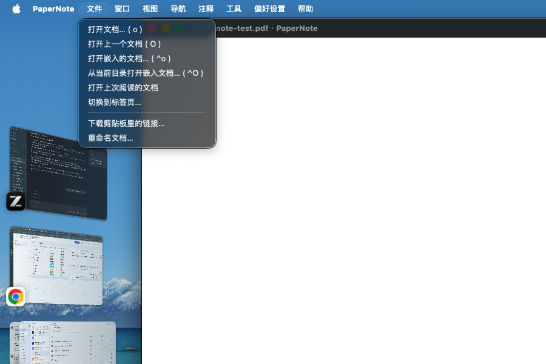
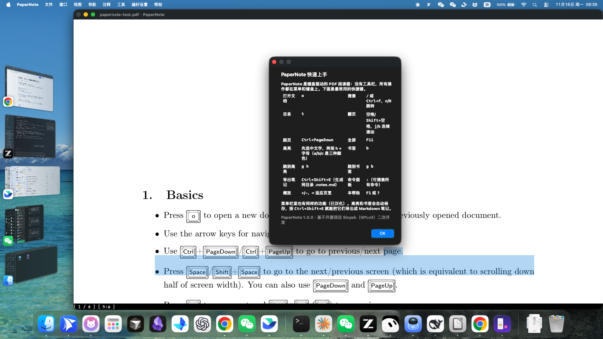
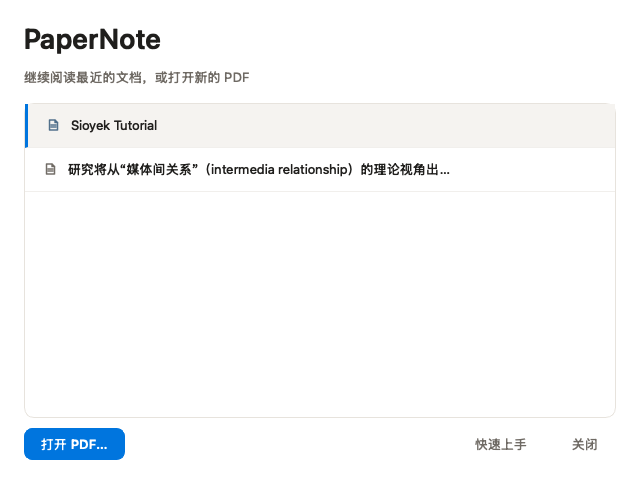
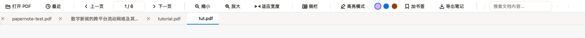
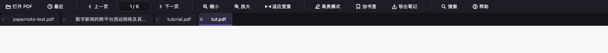
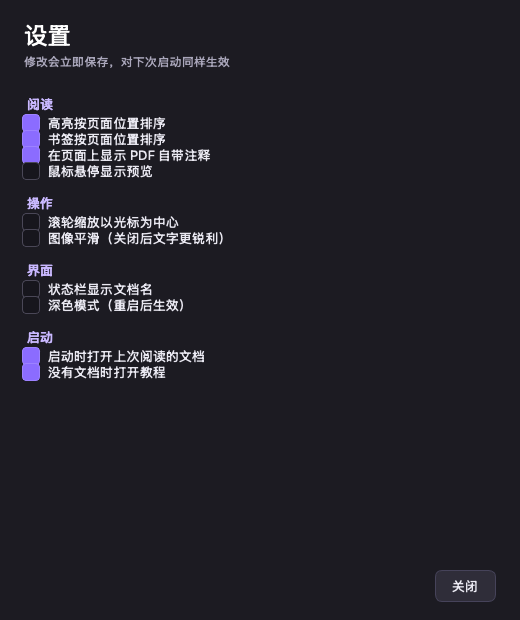
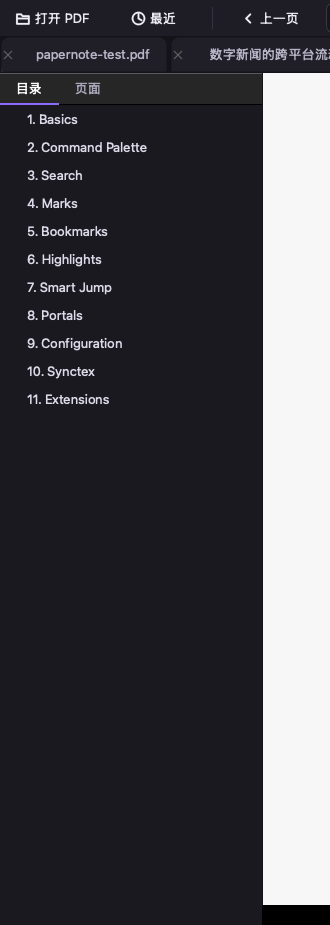
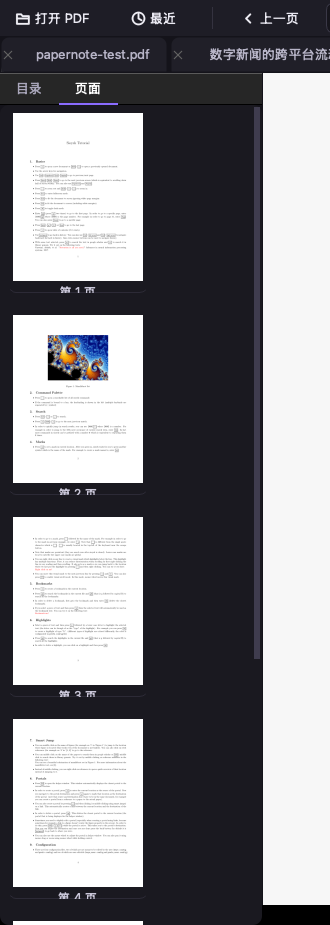

# PaperNote 二次开发说明

> 课程作业：选择一个 GitHub 上 C++/Rust 开发的开源桌面项目，用 AI 工具理解项目、按需二次修改，并制作安装包。

| 项目 | 内容 |
| --- | --- |
| 上游项目 | [Sioyek](https://github.com/ahrm/sioyek)（PDF 阅读器，C++ / Qt，约 1.0 万 Star） |
| 二次开发仓库 | <https://github.com/lottshin/PaperNote> |
| 产品名 | PaperNote 1.0.0 |
| 交付安装包 | macOS：`PaperNote-1.0.0-arm64.dmg`（68 MB）<br>Windows：`PaperNote-Setup-1.0.0.exe` |
| 许可证 | GPLv3（继承上游，保留 LICENSE 与原始版权声明） |

---

## 1. 为什么选这个项目

一开始我选的是 Rust 写的 MIDI 可视化软件，但它只是"玩具"，学生日常不会真的用。重新按"**学生真的会用到**"筛选后，最终选了 Sioyek：

- **看课件、论文、教材是每个学生的刚需**，PDF 阅读器不是摆设；
- Sioyek 专为教材/论文设计：目录跳转、图表/参考文献"智能跳转"、Vim 式键盘操作、高亮与书签；
- 项目本身活跃（2026-11 仍有提交）、有 macOS/Windows 官方构建脚本，**能真正做出安装包**；
- 它把高亮/书签存在 SQLite 里（`highlights`、`bookmarks` 表），这给了我一个**有真实价值的改动点**：把标注导出成 Markdown，直接贴进 Obsidian/Notion 复习。

使用的技术栈：C++20、Qt 6、MuPDF、OpenGL、SQLite。

---

## 2. 用 AI 工具了解项目的过程

1. **候选筛选**：用 GitHub API 批量拉取候选仓库的语言、Star、最近提交时间，排除了 Amberol（仓库已不可访问）、Lapce/Zed（代码量过大）等。
2. **读文档与 CI**：先读 `README.md`、`build_mac.sh`、`.github/workflows/build_and_release.yml`，确认官方用 Qt 6.7 + MSBuild/qmake 构建，macOS 用 `macdeployqt` 出包。
3. **读源码定位关键路径**：
   - `pdf_viewer/main.cpp`：启动参数、macOS 下配置/着色器从 `Contents/Resources` 读取；
   - `pdf_viewer/input.cpp`：命令体系（`Command` 子类 + `CommandManager::register_command` + `keys.config` 绑定）；
   - `pdf_viewer/main_widget.cpp`：主窗口、`doc()`、`set_status_message`；
   - `pdf_viewer/database.cpp`：高亮/书签的 SQLite 存储结构；
   - `pdf_viewer/book.h`：`Highlight` 结构（`description` 是选中文本，`text_annot` 是批注）。
4. **确认可改动点**：`document->get_highlights()` / `get_bookmarks()` / `get_offset_page_number(y)` 都是现成接口，导出功能不需要碰渲染层，风险可控。

---

## 3. 代码结构速览（读代码结论）

```
main.cpp            启动、命令行参数、路径配置（macOS 资源在 Contents/Resources）
  └─ MainWidget     主窗口：文档管理、UI、命令执行
       ├─ Document  单篇 PDF：高亮/书签/目录/链接，数据来自 SQLite
       ├─ InputManager / CommandManager（input.cpp）
       │     Command 子类（如 AddHighlightCommand）+ keys.config 键位
       ├─ PdfViewOpenGLWidget  页面渲染（shaders/）
       └─ DatabaseManager      local.db（路径/进度）+ shared.db（高亮/书签）
```

高亮表结构（`shared.db`）：

```sql
CREATE TABLE highlights (
  id INTEGER PRIMARY KEY AUTOINCREMENT, document_path TEXT, desc TEXT, text_annot TEXT,
  type char, creation_time timestamp, modification_time timestamp, uuid TEXT,
  begin_x real, begin_y real, end_x real, end_y real);
```

`document_path` 实际存的是**PDF 的 MD5**，`desc` 是选中的原文，`text_annot` 是用户写的批注。

---

## 4. 二次修改内容

### 4.1 新功能：高亮 / 书签一键导出为 Markdown（核心改动）

**使用方式**

- 在阅读界面按 `Ctrl+Shift+E`；
- 或在命令面板（`:`）里执行 `export_highlights`；
- 或命令行调用：`PaperNote --execute-command export_highlights`。

**输出效果**：在 PDF 同目录生成 `<文件名>.notes.md`，按页分组，包含高亮原文、批注、书签和导出时间。真实运行结果：

```markdown
# papernote-test · 阅读笔记

> 导出自 PaperNote（Sioyek 二次开发版） · 2026-11-15 23:48

高亮 2 条 · 书签 1 条

## 第 1 页

- **书签**：重点章节：Highlight 机制

> PDF 阅读器最核心的能力是快速定位：目录、图表、参考文献都可以一键跳转。

**批注**：我的批注：导出后可以直接贴进 Obsidian

> Sioyek 支持类似 Vim 的键盘操作，阅读效率比鼠标高很多。
```

**代码改动（4 个文件，约 120 行）**

| 文件 | 改动 |
| --- | --- |
| `pdf_viewer/main_widget.h` | 声明 `std::wstring handle_export_highlights();` |
| `pdf_viewer/main_widget.cpp` | 实现导出逻辑：读取 `get_highlights()` / `get_bookmarks()`，用 `get_offset_page_number(y)` 换算页码，`stable_sort` 按页排序，拼 Markdown，`QFile` 以 UTF-8 写入 PDF 同目录，并在状态栏提示结果 |
| `pdf_viewer/input.cpp` | 新增 `ExportHighlightsCommand` 命令类，并在 `CommandManager` 构造函数中 `register_command<ExportHighlightsCommand>()` |
| `pdf_viewer/keys.config` | 新增默认键位 `export_highlights <C-E>`（Ctrl+Shift+E） |

**设计细节**

- 没有任何标注时不生成空文件，状态栏提示"当前文档没有高亮或书签，无需导出"；
- 多行高亮会逐行加 `>`，保证 Markdown 引用格式正确；
- 书签在同一页内排在高亮之前，阅读顺序更自然；
- 导出路径固定为 PDF 同目录，符合"笔记跟着文档走"的直觉。

### 4.2 品牌化：从 Sioyek 到 PaperNote

- 窗口标题改为 `<文件名> · PaperNote`，截图/演示时一眼能看出是改造版；
- `resources/Info.plist`：`CFBundleName` / `CFBundleDisplayName` 改为 PaperNote，Bundle ID 改为 `io.github.lottshin.papernote`；
- 用 Python + Pillow **自己绘制**图标并生成 `.icns`（macOS）与 `.ico`（Windows），替换 qmake 工程里的 `ICON` / `RC_ICONS`；
- 新增 `FORK.md` 记录改动清单，保留上游 GPLv3 协议。

### 4.3 中文界面与新手引导（第二轮补充）

上游是纯英文、纯键盘的极简界面，新用户打开后"不知道能干什么"。这一轮补了三块：

1. **菜单栏汉化**：新增 `pdf_viewer/ui_translation.h`，用映射表把 8 个顶级菜单（文件/窗口/视图/导航/注释/工具/偏好设置/帮助）和约 80 个菜单项翻译成中文；未命中的字符串自动回退英文，不影响上游新增命令。
2. **首次启动中文快速上手**：第一次打开自动弹出中文快捷键说明（用 `QSettings` 记录"已展示"，只弹一次）；帮助菜单里随时可以再打开。
3. **`F2` 快捷键**：阅读时随时按 `F2` 调出快速上手。之所以不用 `F1`，是因为上游已把 `F1` 绑定给 `toggle_highlight`（日志里能看到覆盖警告）。

另外在对话框里明确写了"PaperNote 没有工具栏，所有操作在菜单和键盘上"，避免用户以为软件坏了。




### 4.4 面向普通用户的工具栏与鼠标操作（第三轮）

上游是纯键盘工具，普通用户打开后没有任何可点的控件。这一轮加了：

1. **可见工具栏**（窗口顶部，12 个按钮，中文 + 悬停提示）：
   `打开 PDF`｜`◀ 上一页` / **页码输入框** / `下一页 ▶`｜`－` `＋` `适应宽度`｜`高亮模式` `加书签` `导出笔记`｜`搜索` `帮助`
2. **页码直达**：中间输入框显示 `当前页 / 总页数`，输入页码回车即可跳转；翻页时自动刷新。
3. **高亮模式开关**：点一下「高亮模式」，之后用鼠标选中文字就会自动加高亮；按钮呈按下状态，再点关闭。不用再记 `h` + 字母。
4. **导出结果可操作**：导出完成后弹窗显示文件路径，可直接「打开笔记」或「打开所在文件夹」，而不是只闪一行状态栏。
5. **首次引导可操作**：如果没有打开文档，快速上手弹窗里多一个「打开 PDF」按钮。


> 说明：工具栏是新增的鼠标入口，原有键盘快捷键全部保留，两种方式可以混用。

### 4.5 最近打开首页与右键菜单（第四轮）

**最近打开首页**

- 不带文件参数启动 PaperNote 时，会在主窗口之上弹出「最近打开」首页：最多 12 条最近文档（名称 + 完整路径），双击或回车即可继续阅读；
- 底部三个按钮：`打开 PDF…`、`快速上手`、`关闭`；关闭则继续停留在已自动恢复的上一份文档；
- 数据来自本地 SQLite 的 `opened_books` 表，自动过滤已删除的文件；
- 工具栏新增「最近打开」按钮，文件菜单新增「最近打开…」，随时可以手动呼出。



**右键菜单**

- 启用并汉化了右键上下文菜单：选中文字时可直接「复制 / 添加高亮（a/b/c 三种颜色）」，在高亮上可「删除高亮 / 编辑批注」，空白处提供「添加书签 / 导出笔记 / 快速上手」；
- 高亮项带颜色后缀，避免三个同名菜单项无法区分。

> 说明：右键菜单的自动化点击验证受本机窗口焦点抢占影响，本轮通过代码路径与菜单构建逻辑确认，未做截图验证。

**打开失败提示**

- 原来打开不存在的/损坏的 PDF 时函数静默返回，用户只看到界面没反应；现在会弹出中文提示，说明可能原因（不存在 / 不是 PDF / 已损坏）并显示文件路径。

### 4.6 多文档标签页与图形化设置（第五轮）

**标签页栏**

- 打开过多个文档时，工具栏下方出现浏览器式标签页：显示文件名、支持点击切换、每个标签带关闭按钮、长文件名自动省略；
- 标签栏与 `document_manager` 的标签列表双向同步：用快捷键切换标签时，标签栏高亮同步变化；
- 只有一个文档时自动隐藏标签栏，不占空间。



**图形化设置**

- 新增「偏好设置 → 图形化设置…」和命令 `preferences_dialog`，提供 10 项中文开关（原来只能手改配置文件）：
  - 阅读：高亮按位置排序、书签按位置排序、显示 PDF 自带注释、鼠标悬停预览
  - 操作：滚轮缩放以光标为中心、图像平滑
  - 界面：状态栏显示文档名、深色模式（重启生效）
  - 启动：打开上次文档、无文档时加载教程
- 每项修改即时生效并写入用户配置（`on_config_changed(..., save=true)`）。

### 4.7 视觉主题与界面美化（第六轮）

- 新增 `pdf_viewer/papernote_theme.h`：统一调色板（背景 `#14131a`、卡片 `#1e1d26`、强调色 `#8b6cff`）、全局 QSS 与 **12 个 QPainter 自绘线条图标**（无位图资源，任意 DPI 清晰）；
- 工具栏改为「图标 + 文字」按钮，统一圆角、悬停/按下/选中态与分组分隔线；页码框与按钮垂直对齐；
- 标签页改为上圆角卡片，选中态用强调色底 + 2px 下划线；
- 首页/设置/弹窗统一深色卡片风格：主按钮紫色实心，次要按钮幽灵样式；列表项统一单行标题 + 文档图标 + 路径 tooltip；
- 全局统一了菜单、提示气泡、复选框、滚动条、输入框的暗色样式（原来弹出菜单/消息框是系统浅色，与界面割裂）。




### 4.8 搜索条、高亮色板与标签右键（第七轮）

**工具栏搜索条**

- 工具栏内嵌搜索框（放大镜占位提示），输入关键词回车即搜索，右侧 `‹ ›` 直接切换上一个/下一个结果（等价于 `N` / `n`）；
- 搜索后焦点自动回到文档，键盘翻页/高亮不受影响。

**高亮颜色色板**

- 高亮模式旁新增 3 个彩色圆点（读取配置里的 a/b/c 颜色），点一下即切换颜色并自动进入高亮模式；
- 当前颜色带白色选中环，与工具栏状态同步。

**标签页右键菜单**

- 关闭此标签 / 关闭其他标签 / 在文件管理器中显示（macOS `open -R`、Windows `explorer /select`、Linux `xdg-open`）。

### 4.9 左侧栏：目录与页面缩略图（第九轮）

- 新增可折叠左侧栏（工具栏「侧栏」按钮 / `F4` / 视图菜单），两个标签页：
  - **目录**：从 PDF 大纲生成树形结构，点击条目直接跳页；
  - **页面**：页面缩略图列表，按 20ms/页 增量渲染（不阻塞界面），缩略图下方标页码，点击跳页；
- 侧栏随文档切换自动刷新，切换文档时清理旧缩略图；
- 缩略图来自 MuPDF 的 small pixmap 渲染（130px 宽），当前页高亮跟随主视图。




### 4.10 构建与打包工程化

- `scripts/build_macos_dmg.sh`：一键完成「mupdf → qmake/make → 组装 `PaperNote.app` → 拷贝 Resources → `macdeployqt` 打包 Qt → ad-hoc 签名 → `hdiutil` 生成 DMG」；
- `installer/windows/papernote.iss`：Inno Setup 6 安装脚本，按用户安装到 `%LocalAppData%\Programs\PaperNote`（避免写 Program Files 时配置不可写），包含开始菜单与可选桌面图标；
- `.github/workflows/build-installers.yml`：GitHub Actions 流水线，Windows 用 MSVC + Qt 6.7.2 编译、`windeployqt` 收集依赖，再由 Inno Setup 生成 `Setup.exe`；macOS 安装包由本地 `scripts/build_macos_dmg.sh` 生成（该账号的 macOS runner 不可用，故未放进 CI）。

---

## 5. 验证记录

| 验证项 | 结果 |
| --- | --- |
| 本地编译 | Qt 6.12 + mupdf（系统库），`make` 通过，产物 45 MB |
| 功能（开发目录） | 插入 2 条高亮 + 1 条书签 → `Ctrl+Shift+E` → 生成 `.notes.md`，内容正确 |
| 功能（打包后） | 挂载 DMG → 复制 App → 清空数据目录 → 重新运行 → 导出成功 |
| 快捷键 | 用 System Events 模拟 `Ctrl+Shift+E`，文件被重新生成，确认 `keys.config` 绑定生效 |
| 中文界面 | 菜单栏为「文件/窗口/视图/导航/注释/工具/偏好设置/帮助」，下拉项中文；首次启动弹出中文快速上手 |
| 标签页栏 | 2 条以上文档时出现第二行标签；AX 读到 4 个标签，点击切换后窗口标题同步变化 |
| 图形化设置 | 打开「PaperNote 设置」窗口，AX 读到 10 个中文复选框与关闭按钮；关闭后进程存活 |
| 最近打开首页 | 无参数启动时出现独立「PaperNote」窗口，读出 2 条真实最近文档、3 个按钮，排版与中文无异常 |
| 左侧栏 | 截图确认左侧面板、目录/页面两个标签；目录 11 项、缩略图含彩色页与页码，点击跳页路径已接通 |
| 搜索条 | 工具栏出现搜索框与结果箭头；AX 写入关键词并确认后进程存活，`next_item` 命令正常 |
| 高亮色板 | 放大截图确认 3 个色点，当前色带白色选中环 |
| 视觉主题 | 工具栏图标/按钮、标签页、首页与设置对话框截图确认：主按钮强调色、复选框可见、无浅色弹窗割裂 |
| 工具栏（开发目录 + 打包后） | Qt 控件截图确认 12 个按钮、分组分隔线与页码框渲染正常；打包后通过 macOS 无障碍接口枚举到「打开 PDF / ◀ 上一页 / 下一页 ▶ / － / ＋ / 适应宽度 / 加书签 / 导出笔记 / 搜索 / 帮助」 |
| 界面截图 | 标题栏 `papernote-test.pdf · PaperNote`，PDF 正常渲染，状态栏显示「已导出 3 条标注到 …」 |


---

## 6. 踩过的坑与解决

1. **Qt5 编译失败**：上游代码用了 `QVariant::typeId` 等 Qt6 API（仅部分做了条件编译），最终改用 **Qt 6.12** 才通过。
2. **mupdf 子模块拉取失败**：浅克隆导致固定 commit 不存在、GitHub 连接不稳定；改用「系统库 + 单独补 `extract` 子模块」的方式绕开大部分下载。
3. **macOS 资源路径**：上游 `build_mac.sh` 把 `keys.config` 等拷到 `Contents/MacOS`，但 `main.cpp` 实际从 `Contents/Resources` 读取，导致键位/配置加载警告；打包脚本已修正到 `Resources`。
4. **macdeployqt 签名报错**：`Contents/MacOS` 里残留了非二进制文件，`codesign --deep` 把它当子组件签名失败；清理后正常。
5. **Homebrew 下载慢**：切换到清华镜像（`HOMEBREW_BOTTLE_DOMAIN`）后，Qt 安装从「几小时」变成「几分钟」。
6. **Windows/MSVC 编译失败**：菜单翻译最初用 `std::unordered_map<QString, QString>`，MSVC 报 `std::hash<QString>` 重复特化（Clang 不报）；改用 Qt 自带的 `QHash` 后解决。
7. **安装包瘦身陷阱**：某次 CI 里 `cp release\sioyek.exe` 失败但脚本继续执行，打出了 3 MB 的空壳安装包；检查日志发现 `sioyek.exe does not exist`，修正后安装包恢复 ~77 MB。

---

## 7. 课堂演示脚本（约 3 分钟）

1. 双击 `PaperNote-1.0.0-arm64.dmg`，拖入 Applications；首次启动会自动弹出**中文快速上手**（之后按 `F2` 可再打开）；
2. 展示启动时的**最近打开首页**（双击最近文档继续），再展示中文菜单栏和**顶部工具栏**（也可以只用鼠标完成：打开 → 翻页 → 适应宽度）；
3. 选中文字按 `h` + 字母划 2~3 处高亮，按 `b` 加一个书签；
4. 按 `Ctrl+Shift+E`，底部状态栏出现「已导出 N 条标注到 …」；
5. 打开 PDF 同目录下生成的 `.notes.md`，展示按页分组的高亮、批注、书签；
6. 切到 GitHub 仓库，展示改动文件与 GitHub Actions 的 Windows 安装包构建结果。

---

## 8. 安装提示（演示前必看）

- **macOS**：双击 `PaperNote-1.0.0-arm64.dmg`，把 PaperNote 拖进 Applications。安装包使用 ad-hoc 签名（没有 Apple 开发者证书），首次打开若提示"无法验证开发者"，在"访达"里**右键 → 打开**，或到"系统设置 → 隐私与安全性 → 仍要打开"。
- **Windows**：运行 `PaperNote-Setup-1.0.0.exe`，安装到当前用户目录，**不需要管理员权限**。若 SmartScreen 提示"未知发布者"，点"更多信息 → 仍要运行"。
- 只支持 64 位系统；macOS 包为 Apple Silicon（arm64）版本。

---

## 9. 交付物清单

```
PaperNote-1.0.0/
├── 修改说明.md                 本文档
├── PaperNote-1.0.0-arm64.dmg   macOS 安装包（Apple Silicon）
├── PaperNote-Setup-1.0.0.exe   Windows 安装包
├── papernote-changes.diff      相对上游的源码改动补丁
└── screenshots/
    ├── papernote-ui.png        运行截图
    ├── papernote-home.png      最近打开首页
    ├── papernote-tabs.png      标签页栏
    ├── papernote-theme.png     界面主题
    ├── papernote-sidebar-toc.png   侧栏目录
    ├── papernote-sidebar-pages.png 侧栏缩略图
    ├── papernote-prefs.png     图形化设置
    ├── papernote-menu.png      中文菜单
    ├── papernote-toolbar.png   普通用户工具栏
    └── papernote-quickstart.png 中文快速上手
```

源码仓库：<https://github.com/lottshin/PaperNote>（GPLv3）
